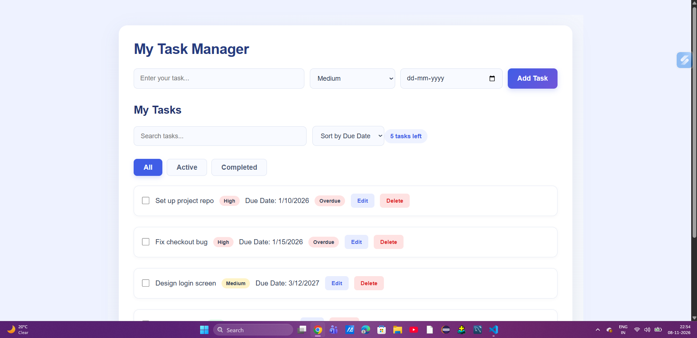
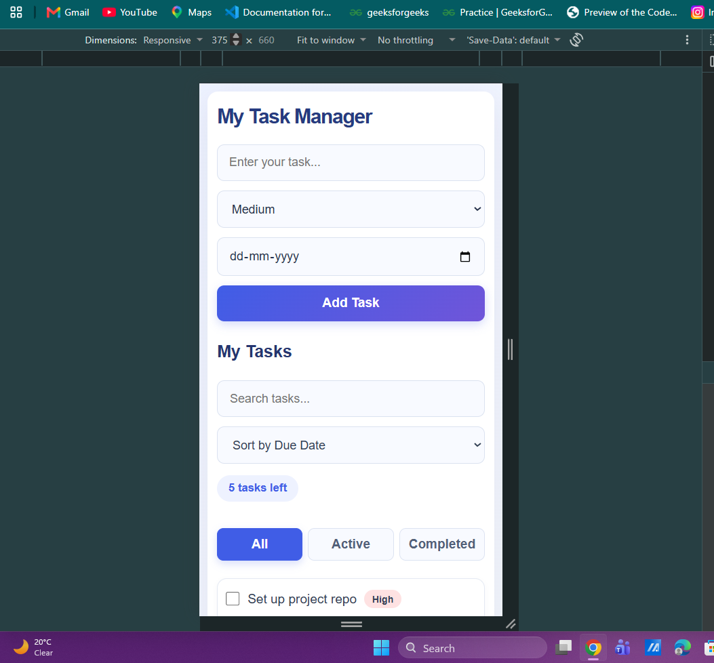

# Task Manager App

A responsive Task Manager application built using React and Vite. It allows users to create, manage, organize, and track their daily tasks.

## Features

- Add tasks with a title, priority, and due date.
- Edit task titles.
- Mark tasks as completed or active.
- Delete tasks with confirmation.
- Filter tasks by All, Active, and Completed.
- Search tasks by title.
- Sort tasks by due date and priority.
- Display overdue tasks.
- Save tasks using browser Local Storage.
- Load initial tasks from a JSON file.
- Responsive layout for desktop and mobile screens.

## Technologies Used

- React
- JavaScript
- HTML5
- CSS3
- Vite
- Browser Local Storage

## How to Run the Project

**Prerequisites:** Node.js and npm must be installed.

1. Clone the repository:

   ```bash
   git clone https://github.com/Divya173-svg/taskManager_app.git
   ```

2. Navigate to the project folder:

   ```bash
   cd TaskManager_project
   ```

3. Install dependencies:

   ```bash
   npm install
   ```

4. Start the development server:

   ```bash
   npm run dev
   ```

5. Open the local URL displayed in the terminal.

## What Works

- Task creation and validation.
- Task editing and deletion.
- Task completion.
- Task filtering and searching.
- Task sorting.
- Overdue task identification.
- Local Storage persistence.
- Initial task loading from `public/tasks.json`.

## What Is Missing or Broken

- No known issues at the time of submission.

## Assumptions

- Initial tasks are loaded from `public/tasks.json` when no saved task data is available.
- Local Storage is used to persist task data in the browser.
- Task data is stored locally; no backend or database is used.
- Due dates are evaluated using the user's local date.

## Time Spent

Approximately 20+ hours.

## Screenshots

### Desktop View



### Mobile View



## Live Demo

https://task-manager-j9xlccvvy-divya-s-projects14.vercel.app/

## Author

Divya

GitHub: https://github.com/Divya173-svg
